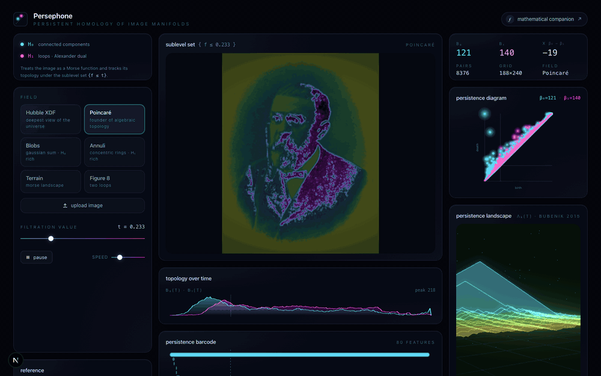

# Persephone

Persistent homology engine for spatial vision. Treats a grayscale image as
a discrete Morse function `f: Ω ⊂ ℤ² → ℝ` and renders the persistent
homology of its sublevel-set filtration `{f ≤ t}` as `t` sweeps from
`min f` to `max f`.



## Mathematical background

A full derivation is in
[`public/persephone-math.pdf`](./public/persephone-math.pdf) (14 pages,
with proofs). The studio computes the persistence diagrams of `H₀(X_t)`
and `H₁(X_t)` over the cubical V-construction filtration `{X_t}`, where:

* `H₀` uses union-find with the elder rule (Edelsbrunner and Harer, 2010).
* `H₁` is recovered via Alexander duality on `S²`: a second union-find
  sweep is run in descending order over the superlevel set, and the
  resulting pairs are reinterpreted in the original frame.
* The Betti curves `β₀(t), β₁(t)` and the persistence landscape
  `λ_k(t)` (Bubenik, 2015) are then computed in closed form on a uniform
  grid.

## What each panel shows

| Panel | Mathematical object |
|---|---|
| Sublevel-set canvas | `X_t = {σ : F(σ) ≤ t}` with a level-set glow whose band width scales with `‖∇f‖⁻¹` |
| Persistence diagram | Multiset `Dgm(H₀) ⊔ Dgm(H₁)` above the diagonal |
| Persistence barcode | Each pair `(b, d)` as a bar `[b, d]`, sorted by birth |
| Betti curves | `β₀(t), β₁(t)` over the filtration range |
| Persistence landscape (3D) | Bubenik landscape `λ_k(t)`, `k = 1, …, 14`, lifted to `(t, λ_k(t), k)` |
| Invariants strip | Live `β₀`, `β₁`, `χ = β₀ − β₁`, `|Dgm|`, raster size |

## Samples

The default field is the Hubble eXtreme Deep Field (NASA/ESA/STScI, public
domain). Other built-in samples:

* Henri Poincaré portrait, *Popular Science Monthly* Vol. 82 (public domain
  via Wikimedia Commons).
* Procedural Gaussian blobs (`H₀` rich).
* Procedural concentric annuli (`H₁` rich).
* Procedural Morse terrain.
* Procedural figure-eight (two `H₁` loops).

Any image can also be uploaded from disk.

## Stack

* Next.js 16, React 19, TypeScript, Tailwind CSS v4.
* WebGL fragment shader for the filtration canvas.
* Three.js with `@react-three/fiber` and `@react-three/postprocessing`
  for the persistence landscape (additive bloom).
* All persistence computation runs client-side in plain TypeScript on a
  Float32 grid; an image of `N` pixels is processed in `O(N α(N))` time
  after the initial radix-style sort.

## Running locally

```bash
npm install
npm run dev
```

Then open `http://localhost:3000`.

## Rebuilding the math PDF

The LaTeX source is `latex/persephone-math.tex`. To rebuild:

```bash
tectonic latex/persephone-math.tex
cp latex/persephone-math.pdf public/persephone-math.pdf
```

## References

* H. Edelsbrunner and J. Harer. *Computational Topology: An Introduction*.
  AMS, 2010.
* G. Carlsson. Topology and data. *Bull. Amer. Math. Soc.* 46 (2009),
  255-308.
* P. Bubenik. Statistical topological data analysis using persistence
  landscapes. *J. Mach. Learn. Res.* 16 (2015), 77-102.
* D. Cohen-Steiner, H. Edelsbrunner, J. Harer. Stability of persistence
  diagrams. *Discrete Comput. Geom.* 37 (2007), 103-120.
* A. Zomorodian and G. Carlsson. Computing persistent homology.
  *Discrete Comput. Geom.* 33 (2005), 249-274.
